

  

    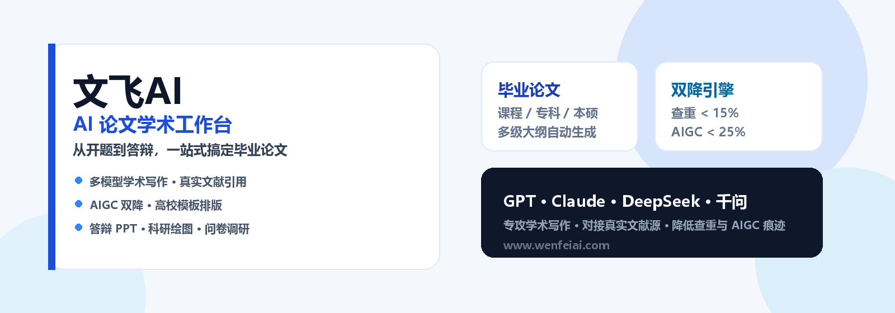
  

  

    
    
    
    
    
  

  

    <a href="https://www.wenfeiai.com">官方网站</a>
    · <a href="https://www.wenfeiai.com/thesisTopic?paperType=1">毕业论文写作</a>
    · <a href="https://www.wenfeiai.com/reduceWeight">AIGC双降</a>
    · <a href="https://www.wenfeiai.com/format">格式排版</a>
    · <a href="https://www.wenfeiai.com/ppt">答辩PPT</a>
    · <a href="https://www.wenfeiai.com/aiTools/plot">科研绘图</a>
    · <a href="#主要功能">功能总览</a>
  

  

    <b>文飞AI · AI论文学术工作台：</b>从开题到答辩一站式搞定毕业论文。集成 GPT / Claude Sonnet / DeepSeek / 千问，对接真实文献源，有效降低查重率与 AIGC 痕迹。
  

  

    ✨ 新人注册即享免费 4000 字写作额度，可免费生成开题报告 / 任务书 
    🌐 立即体验：<a href="https://www.wenfeiai.com"><b>https://www.wenfeiai.com</b></a>
  

  <a href="https://www.wenfeiai.com">
    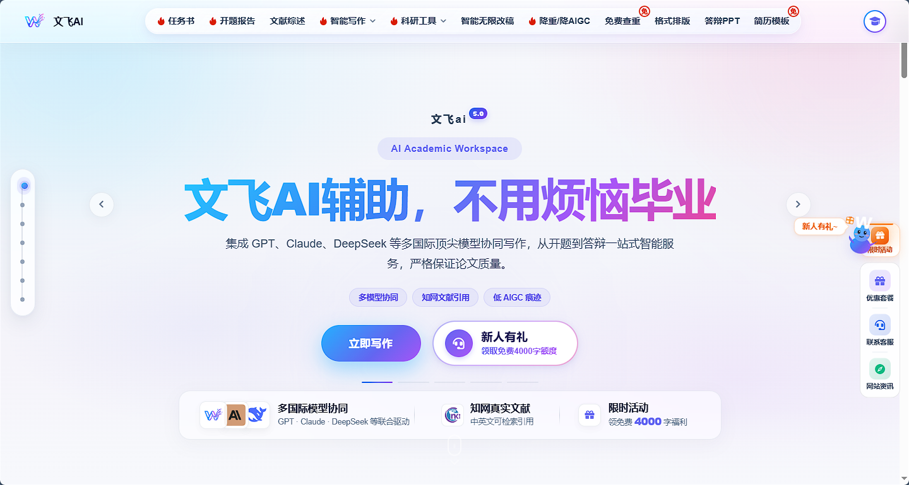
  </a>

---

# 主要功能

毕业全流程工具集，一站覆盖任务书、开题、综述、写作、改写、公式图表、排版、降重、答辩PPT全环节：

- **AI论文写作**：覆盖课程、专科、本科、硕士论文，自动生成多级大纲
- **文献检索引用**：知网中英文文献检索，一键格式化参考文献
- **智能改稿润色**：上传docx文档，AI智能解析全文，支持润色、扩写、精简
- **双降引擎**：查重率&AIGC痕迹双重优化，语义级改写保留原意
- **公式图表生成**：论文公式、数据分析图表AI自动生成插入
- **高校模板排版**：4000+高校格式模板，一键套用自动规范排版
- **科研绘图**：支持200+种设计图生成，覆盖PLC、CAD、工程、科研等多场景
- **答辩PPT生成**：3分钟基于论文大纲产出专业答辩幻灯片
- **问卷生成**：自动生成问卷内容，支持分发填写与收集数据分析
- **本地文档导入**：支持doc/docx格式上传，对已有稿件直接优化改写
- **全文翻译**：一键实现多语言互译，适配外文论文写作需求
- **论文仿写**：基于参考文档风格仿写，保留逻辑与格式规范

---
# 官网直达入口[https://www.wenfeiai.com](https://www.wenfeiai.com)
| 功能 | 直达链接 |
| ---- | ---- |
| 任务书 | https://www.wenfeiai.com/taskBook |
| 开题报告 | https://www.wenfeiai.com/proposal |
| 文献综述 | https://www.wenfeiai.com/literatureReview |
| 本硕论文写作 | https://www.wenfeiai.com/thesisTopic?paperType=1 |
| 专科论文写作 | https://www.wenfeiai.com/thesisTopic?paperType=2 |
| 课程论文写作 | https://www.wenfeiai.com/thesisTopic?paperType=3 |
| 论文仿写 | https://www.wenfeiai.com/imitation |
| 免费查重 | https://www.wenfeiai.com/reduceAigc |
| 降重/降AIGC | https://www.wenfeiai.com/reduceWeight |
| 格式排版 | https://www.wenfeiai.com/format |
| 答辩PPT生成 | https://www.wenfeiai.com/ppt |
| AI科研绘图 | https://www.wenfeiai.com/aiTools/plot |
| 调查问卷 | https://www.wenfeiai.com/questionnaire |

---
## 论文场景适配
匹配不同论文类型，自动适配大纲深度与字数要求

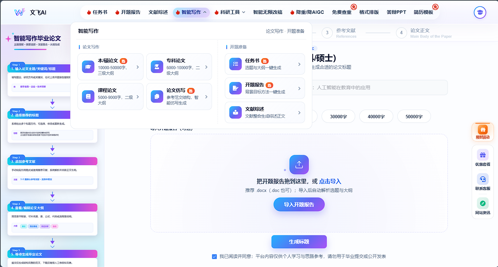

### 课程论文
- 字数范围：5000‑9000字 · 二级大纲
- 特点：侧重课程知识的理解与应用，标准课程论文结构，快速完成课程作业
- 直达入口：[立即创作](https://www.wenfeiai.com/thesisTopic?paperType=3)

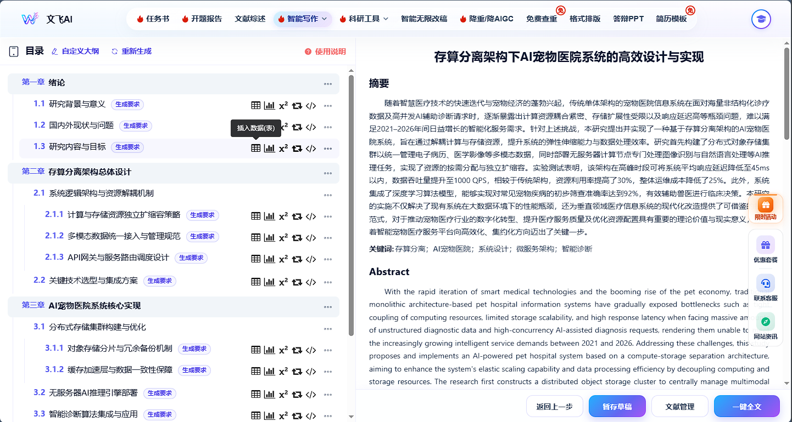

### 本/硕论文✨
- 字数范围：10000‑50000字 · 三级完整大纲
- 特点：更高学术深度与研究维度，完整方法论与理论分析，适配毕业设计与正式答辩
- 直达入口：[立即创作](https://www.wenfeiai.com/thesisTopic?paperType=1)

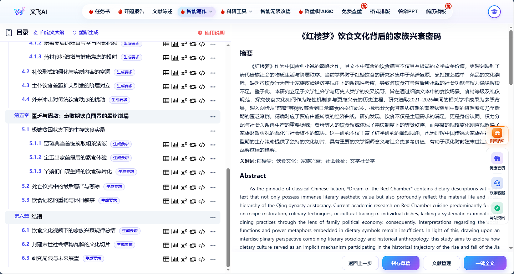

### 专科论文
- 字数范围：6000‑10000字 · 二级大纲
- 特点：侧重应用实践与基础理论，标准专科论文结构，贴合落地应用类选题
- 直达入口：[立即创作](https://www.wenfeiai.com/thesisTopic?paperType=2)

---

## 核心能力模块

### 真实文献源对接
对接市面主流文献库中英文真实文献，一键检索、引用、格式化
- 官方真实文献数据源，中英文期刊文献全覆盖
- 一键插入参考文献，自动标准化[J]等期刊引用格式

> 文献示例：
> [1] 张伟,李娜,王强. 矿物油体系与顺式‑1,4‑聚丁二烯橡胶的性能关系研究[J]. 2024
> [2] A. Mensah, K. Adeyemi. Voices of change: exploring decolonisation in African higher education through social media text mining[J]. 2023

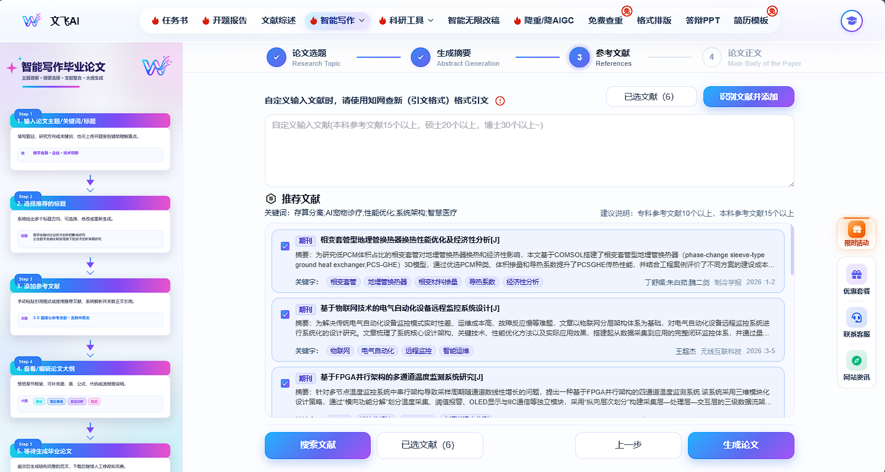

### 2026双降引擎（查重 + AIGC消痕）
对标知网、维普检测标准，查重＜15%，AIGC率＜25%
- 语义级智能改写，完整保留论文研究原意，拒绝同义词堆砌
- 支持上传论文原稿或查重检测报告，两步完成降重优化
- 已适配最新知网和维普检测版本，专业术语与结构锁定，不篡改定理公式与引用

操作步骤：
1. 上传论文原稿 / 上传查重检测报告
2. AI语义级改写双降处理
3. 导出优化后终稿

直达入口：[立即开始双降优化](https://www.wenfeiai.com/reduceWeight)

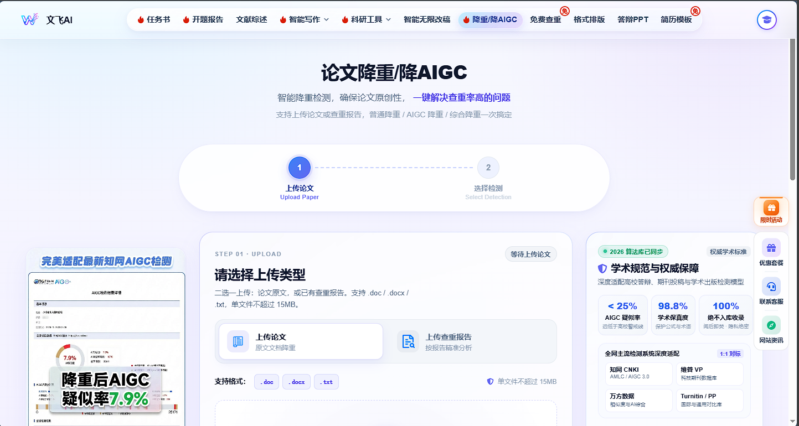

### 高校格式模板排版
4000+高校模板，一键规范排版
- 覆盖全国高校论文排版场景，本科、专科、硕士、博士通用模板齐全
- 支持按学校、学历、专业筛选模板，自动匹配封面、目录、页眉页脚格式
- 一键自动排版，统一目录、页眉页脚、参考文献格式

直达入口：[格式排版](https://www.wenfeiai.com/format)

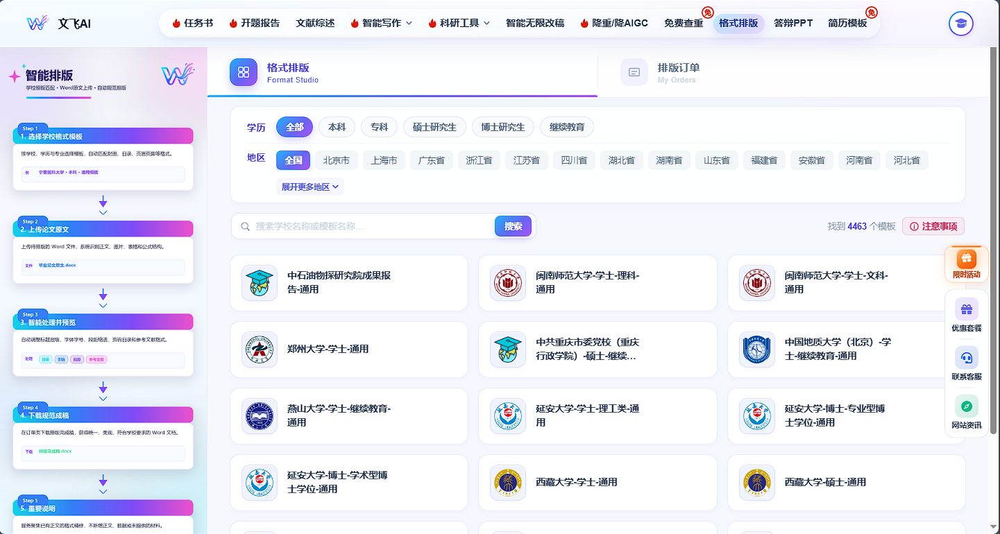

### 智能答辩PPT生成
3分钟一键生成答辩PPT，深度匹配论文大纲结构
- 自动生成目录、研究背景、研究方法、结果结论等完整页面
- 海量学术风格模板可选，适配开题、答辩、课程汇报等多场景
- 支持上传论文直接生成，也可手动输入大纲自定义生成

直达入口：[一键生成答辩PPT](https://www.wenfeiai.com/ppt)

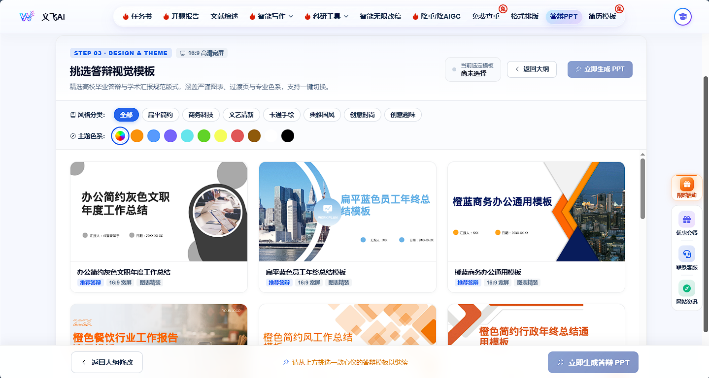

### AI科研绘图
数百种设计图类型，多风格图形库，快速AI生成
覆盖品类：仿真图、光学成像图、化学物理图、地理信息图、工程设计图、建筑图、机器学习图、生物医学图、电子电路图、统计分析图、自动化控制图等。

直达入口：[AI科研绘图](https://www.wenfeiai.com/aiTools/plot)

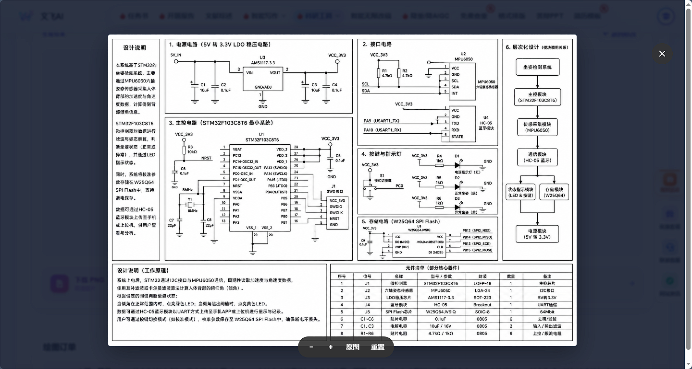

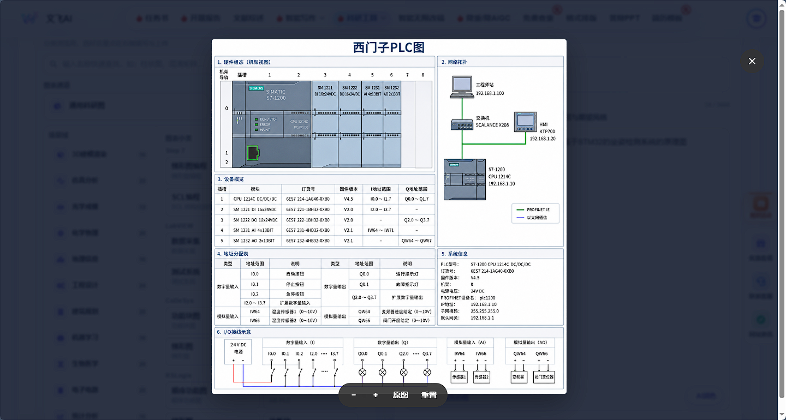

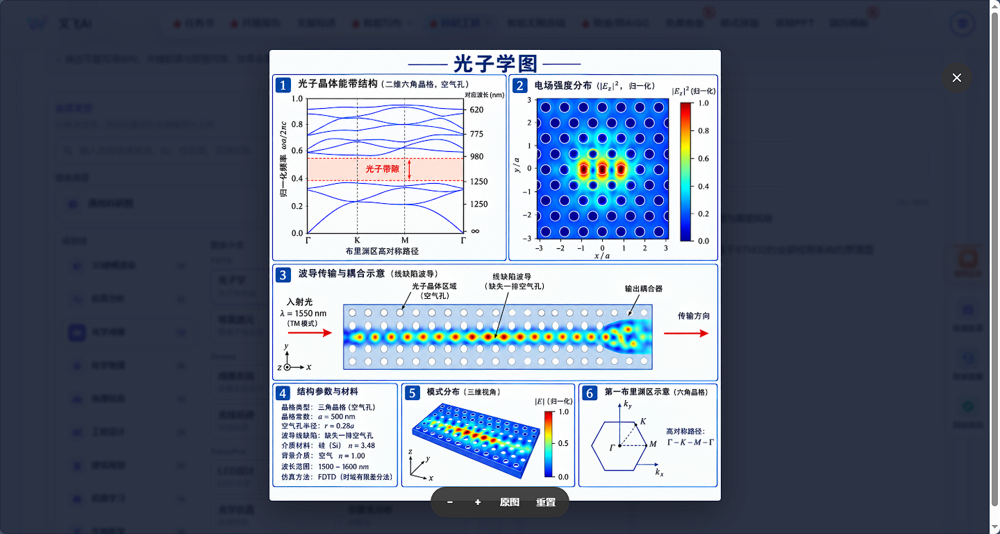

---

## 使用流程
零门槛上手，无需提示词功底

1. 选择论文场景：课程论文 / 专科论文 / 本硕论文
2. 输入选题与要求，AI自动生成多级大纲
3. AI生成初稿，支持在线编辑、润色扩写、插入文献引用
4. 双降优化 + 模板排版，生成答辩PPT，导出docx终稿

---

## 🎁 金秋礼遇限时活动
免费领取字数无上限，完成对应任务即可领取福利，多做多得。

### 1. 抖音关注福利：免费领取4000字
- 福利内容：免费4000字写作额度，可直接生成开题报告/任务书，也可用于文献综述、论文、仿写抵扣
- 领取方式：
  1. 抖音搜索「文飞ai」关注官方账号
  2. 进入粉丝群，对最新视频完成三连互动
  3. 评论区留下你的用户ID，联系抖音客服领取

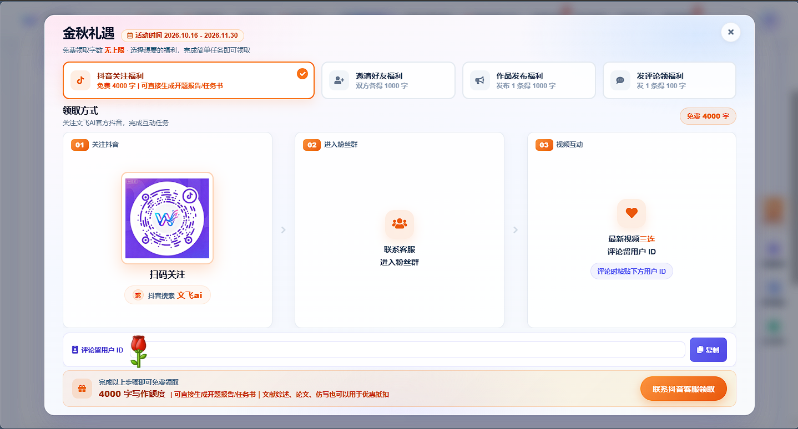

### 2. 邀请好友福利：双方各得1000字
- 福利内容：每成功邀请1位好友注册，双方各得1000字写作额度
- 领取方式：
  1. 复制专属邀请链接
  2. 好友通过链接注册成功后，双方账户自动到账
  3. 多邀多得，上不封顶

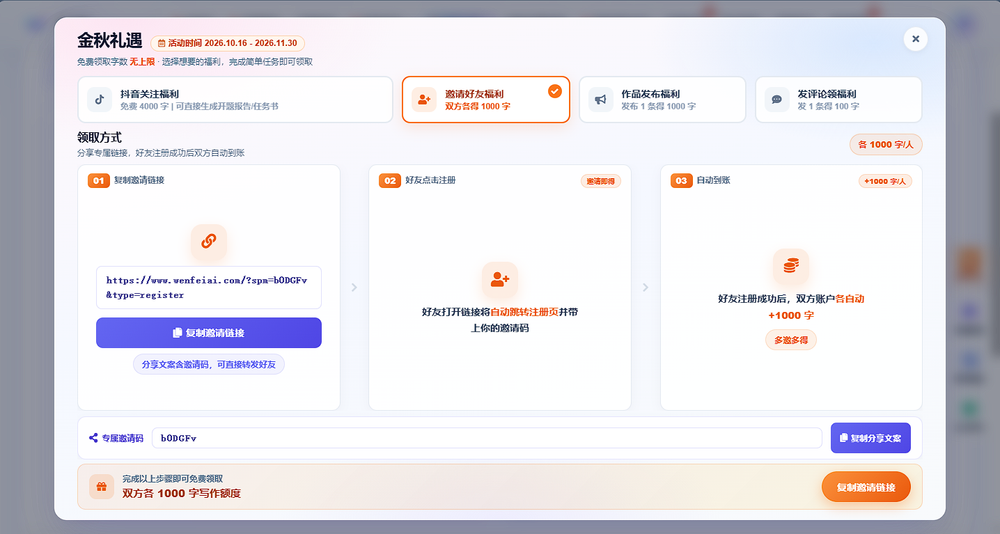

### 3. 作品发布福利：发布1条得1000字
- 福利内容：每发布1条宣传内容，审核通过得1000字写作额度
- 领取方式：
  1. 在抖音/B站发布视频/图文，带上话题#文飞AI
  2. 上传发布3天后的数据截图凭证
  3. 提交审核，通过后自动到账

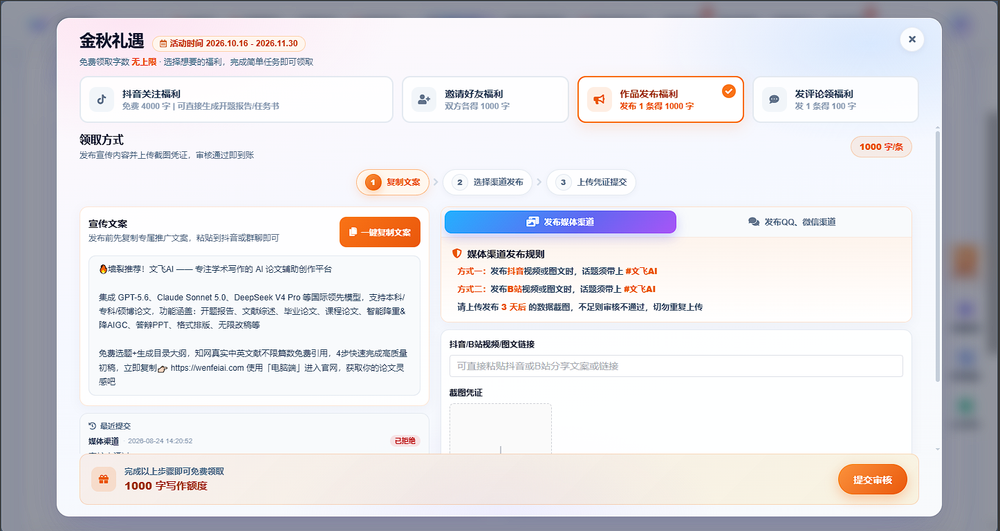

### 4. 评论互动福利：发1条得100字
- 福利内容：每发布1条有效评论，得100字写作额度
- 领取方式：在官方视频评论区留言并留下用户ID，联系客服登记领取

---

---
# 官网直达入口[https://www.wenfeiai.com](https://www.wenfeiai.com)
| 功能 | 直达链接 |
| ---- | ---- |
| 任务书 | https://www.wenfeiai.com/taskBook |
| 开题报告 | https://www.wenfeiai.com/proposal |
| 文献综述 | https://www.wenfeiai.com/literatureReview |
| 本硕论文写作 | https://www.wenfeiai.com/thesisTopic?paperType=1 |
| 专科论文写作 | https://www.wenfeiai.com/thesisTopic?paperType=2 |
| 课程论文写作 | https://www.wenfeiai.com/thesisTopic?paperType=3 |
| 论文仿写 | https://www.wenfeiai.com/imitation |
| 免费查重 | https://www.wenfeiai.com/reduceAigc |
| 降重/降AIGC | https://www.wenfeiai.com/reduceWeight |
| 格式排版 | https://www.wenfeiai.com/format |
| 答辩PPT生成 | https://www.wenfeiai.com/ppt |
| AI科研绘图 | https://www.wenfeiai.com/aiTools/plot |
| 调查问卷 | https://www.wenfeiai.com/questionnaire |

---

## 客服与支持
- 服务时间：7×24小时在线服务
- 客服QQ：2544105379
- 服务范围：论文辅助、降重辅助、格式排版、答辩PPT辅助、科研绘图、商务合作

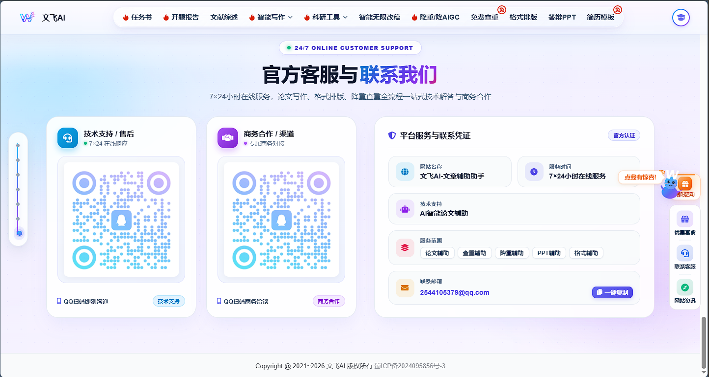
